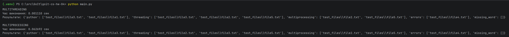

# Домашнє завдання #4 до модуля “Конкурентність та паралелізм”

### Основні деталі реалізації:
1. **Розподіл файлів**:
    - В обох функціях (`search_keywords_threading` та `search_keywords_multiprocessing`) список paths ділиться на рівні шматки (`file_chunks`) залежно від заданої кількості потоків/процесів.

2. **Передача даних та синхронізація**:
    - У `threading` результати потоків захищені об'єктом `Lock` при записі в спільний словник `results`.
    - У `multiprocessing` кожний процес відправляє свої локальні результати у чергу `multiprocessing.Queue`, з якої головний процес збирає й об'єднує підсумковий словник.

3. **Обробка помилок**:
    - При зчитуванні файлів обробляються винятки `OSError`, `UnicodeDecodeError`, `PermissionError`, а також перевіряється існування файлів.

4. **Формат результату та вимірювання часу**:
    - Обидва підходи повертають словник виду `{"слово": ["path/to/file1.txt", ...]}`.
    - Замір часу здійснюється за допомогою модуля `time.time()` і виводиться в консоль.

